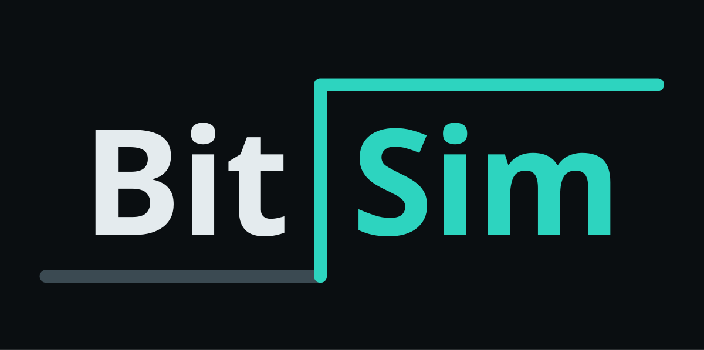

<p align="center"></p>

# Bit Simulator 

An interactive **digital circuit simulator** and **Verilog synthesiser**.

# Descrtiption 

**Bit Simulator** is designed to simulate any digital circuit, also it also has the ability to compile **Verilog** code in program and import the schematic of the synthesised circuit, meaning its a full **Verilog simulator**. 

This application is using **C++** and the **Qt framework** for the GUI layer. It is also using **sv2v** to turn SystemVerilog into plain Verilog, **GHDL** to turn VHDL into Verilog, and the **Yosys** open source synthesiser to compile it. For the layout of the components after the synthesis its using the **Graphviz** library. 

# Running Bit Simulator

Download the appropriate zip file for your OS. Unzip the zip file, and run the executable called **BitSimulator**. Graphviz comes with it; nothing else needs to be installed.

# Using Bit Simulator

You can add individual logic components to the project by selecting the component button in the toolbar and **middle clicking** on an empty spot in the Schematic Editor. You can connect components to each other by pressing **right click** near a port of a component and dragging it to the port of another component, if the connection is **valid** it will connect.

Controls in the Schematic Editor:

| Action | Control |
|---|---|
| Place the selected component | Middle click on empty space |
| Connect two ports with a wire | Right click on a port and drag to another port |
| Pan the schematic | Left click on empty space and drag |
| Select / move a component | Left click on it / left click and drag it |
| Deselect | Left click on empty space |
| Delete the selected components (with their wires) | Delete or Backspace |
| Copy / cut the selected components | Ctrl+C / Ctrl+X (the wires between them come along) |
| Paste | Ctrl+V: at the mouse pointer, or in the middle of the view if the pointer is elsewhere; pasting again at the same spot puts each copy a little lower and to the right |
| Undo / redo | Ctrl+Z / Ctrl+Y (not while the simulation runs; a paused run ends, as with any edit) |
| Zoom in / out | Mouse wheel |
| Find an input or output | Type in the search bar (top right); click a result, or press Enter when there is only one |

Undo covers every change to the circuit: placing, deleting, wiring, settings, names, moving (one step per drag) and Clear. Typing into one settings field is a single step. New, Open and a compile start a new history; undoing back to the saved state clears the `*` in the title again.

The search bar matches the names of sources and displays as a regular expression, in any case (`^data\d+$`, `rst|clk`); text that is not a valid expression yet is matched as it is. Jumping to a result leaves any open block, zooms in on the component and selects it.

The **Properties** panel on the right of the Schematic Editor shows the settings of the selected component (number of inputs, register type, source values, and so on) and lets you change them after the component has been placed. With nothing selected, it says so and shows the settings for the next component you place. A change that would remove a pin with a wire on it is refused until you remove the wire.

The panel floats over the canvas. Drag its title bar to move it anywhere on the canvas; it stays near the side you moved it to when the window is resized. The button at the right of the title bar, or a double-click on the title bar, minimizes it to just the title bar and brings it back.

A **source** drives its output pins (one per bit, lowest bit on top) with a new value every N simulation ticks ("Every"). Its **Mode** decides the values:

| Mode | What it outputs |
|---|---|
| Counter | Start, Start + Step, Start + 2·Step, ... (or counting down). Wraps around at the number of bits: with 8 bits, 255 is followed by 0. |
| Gray code | A counter in Gray code: exactly one pin changes per step. |
| Walking one | A single 1 moving one pin per step: 1, 2, 4, 8, ... |
| Random | A random number over all bits every step; the same seed gives the same numbers on every run. |
| List | The numbers you enter (up to 65,536), then the list repeats. Decimal, `0x` hex and `0b` binary all work. |
| Waveform | A pattern of 0s and 1s for each pin, each repeating on its own. Type a pattern or click its steps. |

A list or waveform starts again after its last step. With **Repeat** unchecked it stays on its last value instead, e.g. a reset pulse `1 1 0` that is 1 for two steps and then 0 for good.
| Constant | Always the same number. |

Sources can be up to 64 bits wide. The panel shows the first few values, so you can see what a setting does. While the simulation runs, a source's color shows its value: gray when all of its pins are 0, teal (the color of a wire carrying 1) when all are 1, and in between by how many are 1, so a 4-pin source moves a quarter of the way per pin at 1. When Verilog is compiled, each input of the top module becomes a source and each output a display, with the port's name from the code at its top (they are made wide enough for it). A source or display placed by hand gets an automatic name, "Source 1", "Display 2" and so on (the lowest number not in use, kept when others are deleted); the **Name** field in the Properties panel renames it, and an empty name gives it an automatic one again. The names are also used in the waveforms. A 1-bit input becomes a waveform toggling every tick, and a wider input a counter that holds each value for 2 ticks. A 1-bit input named like a reset (`rst`, `reset`, `rst_n`, `resetn`, `sys_reset`, ...) is a constant 0 instead: toggling with the clock, it would reset the circuit on every clock edge. As in an HDL simulator such as ModelSim, a flip-flop takes its new value at the clock edge and shows it in that same tick, and an asynchronous reset acts in the tick it rises. Flip-flops power up as 0, so a circuit that needs a reset (a CPU starting at its reset address, say) stays where it powered up until it gets one. Select the reset's source and make it a waveform `1 1 0` with Repeat unchecked: a reset pulse at the start, then 0.

Flip-flops and latches are simulated as the Verilog describes them: on the rising or falling clock edge, with an enable, and with a synchronous or asynchronous reset (an asynchronous one, as in `always @(posedge clk or posedge rst)`, acts at once without waiting for the clock) to any value, including active-low resets and enables and `initial` power-up values. A flip-flop with both an asynchronous set and an asynchronous reset is not supported; compiling one gives an error.

Running the simulation:

- **Start** runs the circuit. The button then turns into **Pause**.
- While the simulation is running the circuit is read-only: you cannot place, wire, delete, cut, paste or edit components. You can still move and copy them, pan and zoom.
- **Pause** freezes the simulation with its values still shown. Pressing **Start** again continues from where it stopped.
- **Reset** ends the run, running or paused, and keeps the circuit: every value goes back to 0, the run's waveforms are cleared, and the next **Start** begins again from the first tick with every flip-flop at its starting value. Changing the circuit while it is paused also ends the run, but keeps its waveforms.
- **Clear** stops the simulation and empties the Schematic Editor.


You can also write **Verilog** code in the **Compile file** tab of the program. Pressing **Compile** at the bottom right of the tab turns your Verilog code into a fully synthesized circuit and shows it on the canvas, where you can simulate it. Compiling stops a running simulation. If the code compiles, the new circuit replaces the one in the Schematic Editor; if it has an error, the error is shown and the current circuit is kept. The top module can have any name: it is found automatically (the module no other module uses). Modules it uses that are written in the same text become blocks (see below).

To compile a whole project instead, open the **Compile Dir** tab and press **Select path...** (or type a folder and press Enter). Every Verilog (`.v`) and SystemVerilog (`.sv`) file in the folder and its subfolders is listed with a checkbox; uncheck the files to leave out, such as testbenches. **Compile directory** compiles the checked files. As in the editor, the top module is found automatically, and submodules in other files become blocks. `` `include `` files are found next to the file that includes them or anywhere in the project folder.

**VHDL** works the same way: write or paste it in the **Compile file** tab (it is recognized by its `entity ... is` declarations), or compile a folder with `.vhd` / `.vhdl` files. GHDL turns it into Verilog first. It reads VHDL-2008 and allows the Synopsys packages such as `std_logic_unsigned`. The top entity is found automatically (the entity no other entity uses), and the entities it uses become blocks named after them; an entity used with different generics becomes one block type per set of values. A folder can mix both languages: a Verilog module can use a VHDL entity by its name. All the VHDL of a design must sit under one top entity, so leave out VHDL testbenches.


## Submodules: blocks

Every submodule instance in the design is drawn as one **block**: a box with the instance and module name, e.g. `alu (ALU)`, its input ports on the left and output ports on the right. Selecting a block shows its module and ports in the Properties panel.

- **Double-click** a block to open it: the canvas shows the inside of that module, its ports as tags at the edges. Blocks inside it open the same way.
- The path at the top left shows where you are, e.g. `RISCV_FPGA › core (RISCV) › alu (ALU)`. Click an entry to go back to it, or press **Esc** to go back one level. Compiling again or pressing Clear goes back to the top.
- The whole design is simulated, blocks included. While the simulation runs or is paused, the inside of a block shows its live values.
- Only the top level can be edited. Inside a block you can pan, zoom and watch, but not place, wire, move or delete anything; change the Verilog and compile again instead.
- A block can be copied and pasted at the top level like any component. The copy gets its own instance name (`u` becomes `u_2`), so its values and waveforms stay apart. Blocks paste only into the compiled design they were copied from: after compiling again, they are left out.

Each module is laid out by Graphviz dot. A module with fewer than 2,000 cells (gates, multiplexers, flip-flops and blocks) gets dot's full layout. A bigger one gets a fast dot: dot stops its two slowest steps early, so the layout is a little less tidy but done in seconds instead of minutes. A full layout can still take a while: the 1,215-cell core of a RISC-V CPU takes about a minute. All modules are laid out at the same time, each by its own dot, so a design takes as long as its slowest module. If dot takes longer than 2 minutes, the next faster layout is used: full dot, then fast dot, then placing the module in columns by logic level. The limits are `FastDotCells` and `DotTimeoutMs` in `BitSimulator/hdlcompiler.h`.

Here is the a sample verolog code you can try, it creates a circuit that mutiplies two numbers: 
```
module top (
    input  wire       clk,
    input  wire [7:0] a,
    input  wire [7:0] b,
    output reg  [8:0] result
);

always @(posedge clk) begin
        result <= a * b;
end

endmodule
 ```

## Waveforms

The **Waveforms** tab shows the circuit's inputs and outputs over the ticks of a run, like the wave window of an HDL simulator. When a run starts, every source and display of the circuit is listed; the tree on the left adds more: check a port of a block (or a whole block, for all of its ports) to show it, uncheck it to remove it. Internal wires are not signals; a block's ports are, at every level.

Every port of every block is recorded from the first tick, so a port added later still shows its whole run. Recording happens in the simulator itself and costs no measurable time; it keeps up to 1 GB of changes (134 million), then drops the oldest quarter of the run at a time.

| Action | Control |
|---|---|
| Move back and forward in time | Mouse wheel, drag with the left mouse button, or the scroll bars |
| Scroll the rows up and down | Shift+mouse wheel, or the scroll bar |
| Zoom in / out around the pointer | Ctrl+mouse wheel, or the Zoom in / Zoom out buttons |
| See the whole run | Fit |
| Cursor (the values column shows the values at it) | Click |
| Second cursor, to measure the ticks between them | Shift+click |
| Radix (hex, unsigned, signed, binary), expand or collapse, move, remove | Right-click a row |
| Split a bus into bits or into words of 8, 16, 32, 64 or any number of bits | Right-click a row › Split into |
| Expand or collapse a bus (keeps its split) | Click its arrow, or double-click its name |

Arrays such as a register file reach the netlist as one wide port: `output logic [31:0] regs_out [31:0]` becomes the 1024-bit `regs_out[1023:0]`. **Split into › 32-bit words** shows it as `regs_out[31]` … `regs_out[0]`, one register per row.

The tab has its own **Start / Pause** and **Reset** buttons, the same as the ones on the circuit's toolbar, so a run can be started, paused, continued and reset without leaving the waveforms. While the simulation runs, **Follow** keeps the newest tick in view; dragging turns it off and the button turns it back on. When the run stops, its waveforms stay until the next Start; **Reset** clears them at once (the signals shown and their settings stay).

**Export VCD...** saves the run as a Value Change Dump for GTKWave, Surfer, ModelSim or any other wave viewer: every input and output of the circuit and every port of every block, in a scope per block instance, with one tick as 1 ns. A value at time t is the value after tick t, as the waveforms show it. The next run of the same circuit keeps the signals and their settings; compiling or clearing starts over with the new circuit's inputs and outputs.

## Saving and Opening Circuits
The **Files** tab has **New**, **Open...**, **Save** and **Save As...** (also Ctrl+N, Ctrl+O, Ctrl+S, Ctrl+Shift+S), and lists the circuits in the `saves` folder next to the executable; double-click one to open it, or right-click it to delete it. **Save As** asks for a name and saves into that folder; **Open** can open a `.bitsim` file from anywhere.

A `.bitsim` file is JSON: every component with its settings, position and name, and every wire. A circuit compiled from HDL is saved with its compiled design, blocks included, so it opens without the HDL files or tools. The window title shows the file's name, with a `*` while there are unsaved changes; closing, New, Open, Clear or a compile then asks whether to save them first. A compiled circuit counts as untitled and unchanged until it is edited, since it can always be compiled again.

# Compiling the Project
The easiet way to compile the project is to install **Qt Creator** IDE and clone and open the project there. Then use the IDE to build the project. The IDE will install the Qt dependancies.  

Everything the app runs besides itself is in `third_party/`: `yosys_bundle` (yosys for Linux), `oss-cad-suite` (yosys for Windows), `ghdl` (ghdl for Windows) and `graphviz`; the build copies or builds them next to the executable.

Graphviz is a git submodule in `third_party/graphviz`. Clone with `git clone --recursive`, or run `git submodule update --init --depth 1` after cloning; if you forget, the first CMake run fetches it.

The first build also builds Graphviz's `dot` (a few minutes) and puts it next to the executable; later builds reuse it. What is built and why is described in `third_party/graphviz-support/Graphviz.cmake`:

- Graphviz 16.1.1 with one change (`ns-compact-arrays.patch`): the slowest part of dot's layout runs on a compact copy of its data. It makes exactly the same choices, so the layouts are the same, about twice as fast on large circuits.
- Only `dot`, linked statically, built with link-time optimization, and with GCC also profile-guided optimization (option `BITSIM_DOT_PGO`).
- Without Pango or Cairo: dot uses Graphviz's built-in font metrics, needs no font libraries, and lays out a circuit the same way on every OS.

Building Graphviz needs `bison` and `flex`. On Linux install them from your package manager (Arch: `pacman -S bison flex`, Debian/Ubuntu: `apt install bison flex`). On Windows nothing is needed: CMake fetches Graphviz's own copies (the small `graphviz-build-utilities` submodule inside `third_party/graphviz`).

# The Browser Version

BitSimulator also builds for web browsers with Qt for WebAssembly, as a demo of the desktop app: its **?** button says so and links to the downloads. Drawing, simulating, waveforms, undo, copy and paste work as in the desktop app. The differences:

- **Compiling:** plain Verilog only, and the SystemVerilog that Yosys reads itself. VHDL (GHDL) and SystemVerilog packages and imports (sv2v) need the desktop app, as does the **Compile Dir** tab, since a web page cannot read a folder. Yosys ([YoWASP](https://yowasp.org/), about 50 MB, downloaded when the **Compile file** tab is first opened) and Graphviz dot run in Web Workers, the browser's background threads, so the page keeps working while a design compiles. As on the desktop, every module is laid out by its own dot at the same time, a dot that takes longer than 2 minutes is stopped and the next faster layout used, and a design is laid out exactly as on the desktop.
- **Saving:** the saves are kept in the browser's storage. **Open...** opens a `.bitsim` file from your computer and adds it to the saves; right-click a save and choose **Download** to get the file. **Export** in the Waveforms tab downloads the VCD file.
- Closing the tab with unsaved changes asks before leaving the page.

To build it, install the **WebAssembly (single-threaded)** component of Qt 6.12 and the Emscripten version that Qt was built with, 5.0.5 for Qt 6.12.0. Qt stops with an error on any other version, so a distribution's `emscripten` package usually does not fit; install it with [emsdk](https://github.com/emscripten-core/emsdk) instead. The build looks for the emsdk in `/usr/local/bin/emsdk`; for another folder, set the `EMSDK` environment variable or pass `-DBITSIM_EMSDK=<folder>`. Then:

```
~/Qt/6.12.0/wasm_singlethread/bin/qt-cmake -S . -B build/wasm -G Ninja -DCMAKE_BUILD_TYPE=Release
cmake --build build/wasm
```

The first build fetches YoWASP with npm and builds Graphviz. `build/wasm/BitSimulator` then holds the whole site (the page, `dot-worker.js` and `yosys-worker.js` from `BitSimulator/web`, `graphviz/` and `yowasp/`): serve that folder with any web server (for example `python3 -m http.server -d build/wasm/BitSimulator`) and open the site's address: its `index.html` (from `BitSimulator/web`) shows the logo while the app loads. A host should send `.wasm` files compressed, which makes them about a third of their size.

# Light and Dark Mode

BitSimulator starts in your system's light or dark setting and follows it while it runs. The round button at the right end of the toolbar switches between the two modes; once you have used it, the app keeps your choice until it is closed.

# Changing the Colors

`BitSimulator/BitSimulator.ui` holds only what Qt Designer can edit: the layout, sizes and texts. Everything else about the look is in code, in `BitSimulator/Theme.h` and `BitSimulator/Theme.cpp`.

- **Colors:** `makeTheme()` in `Theme.cpp` has one line per color, with its dark-mode and its light-mode value side by side, e.g. `t.andGate = pick(0xe8b05a, 0xc4891d);`. The names are the fields of `struct Theme` in `Theme.h`, which says what each one colors.
- **Widget styles:** the style sheet in `Theme.cpp` (`SheetTemplate`) is written once for both modes. It names colors as `@name`, e.g. `@accent` for `Theme::accent`, and the app fills in the colors of the current mode. A style sheet may use only the colors listed in `SheetColors` next to it; the app warns about any other name, and the `tst_theme` test fails on one.
- **Canvas, components and toolbar icons** are painted in code with `currentTheme()`, e.g. `wireHigh` for a wire carrying 1 and `dot` for the dot grid. A component's inside is tinted with its outline color; `componentTint` sets how strongly (0 = no tint, 0.5 = halfway, 1 = the outline color).
- The arrow, check-mark, sun and moon images are in `BitSimulator/theme`.
- **Logo and app icon:** `BitSimulator/icons/source` has the two logos (`logo.svg`, `logo-square.svg`). After changing them, run `python3 BitSimulator/icons/make_icons.py` (it needs `rsvg-convert`, ImageMagick, fontTools and Noto Sans Bold). It writes the logos with their text as outlines, the window icon at every size (the rising edge alone up to 48 px, where text can't be read, the square logo from 64 px), `bitsimulator.ico` for the Windows `.exe` and `favicon.ico` for the browser tab.

# Running the Tests

The project has automated tests in the `tests` folder. They are optional: a normal build does not build them.

On Linux, from the project folder:

```
./run_tests.sh
```

This builds the app and the tests in `build/tests` and runs them all without opening any windows. `./run_tests.sh -R simulator` runs only the tests whose name contains "simulator", and `BITSIM_SHOW_GUI=1 ./run_tests.sh` shows the windows while the tests drive them.

On any system (or inside an IDE), turn on the CMake option `BITSIM_BUILD_TESTS` and build the target `check`:

```
cmake -S . -B build/tests -DBITSIM_BUILD_TESTS=ON
cmake --build build/tests --target check
```

In Qt Creator you can also switch `BITSIM_BUILD_TESTS` on under Projects > Build Settings > CMake and use the Test Results pane.

| Test | What it checks |
|---|---|
| `tst_itemprops` | Small helper functions (bits needed for a value, select lines of a multiplexer, ...) |
| `tst_simulator` | The simulation itself: every gate's truth table, multiplexers, flip-flops and latches, pause and continue |
| `tst_scene` | Components and their pins, the editing rules, and how the drawing is turned into what the simulator runs |
| `tst_panel` | The Properties panel, with simulated clicks and typing |
| `tst_lifecycle` | Start, Pause, Reset, Clear and Compile with the simulator running in its own thread |
| `tst_hdlcompiler` | Compiling Verilog, and blocks: simulating through them and opening them (needs yosys, sv2v and Graphviz; skipped if they are missing) |
| `tst_theme` | Light and dark mode, the style sheet's colors, the canvas dots |
| `tst_waveform` | The waveforms: what the simulator records, the history, the view's zoom, pan and cursors, and the signal tree |

# Third Party Software


This project includes binaries from:

- Yosys – Licensed under the ISC License.
  Copyright (C) 2012-2025 Claire Xenia Wolf.
  License in ./licenses/Yosys-ISC.txt

- Noto Sans (browser version only) – the interface font, licensed under the SIL Open Font License 1.1.
  BitSimulator/fonts/NotoSans-Regular.ttf and NotoSans-Bold.ttf. License in ./licenses/NotoSans-OFL-1.1.txt

- YoWASP Yosys (browser version only) – Yosys compiled to WebAssembly by the YoWASP project, licensed under the ISC License.
  Fetched from npm (@yowasp/yosys) when the browser version is built. License in ./licenses/Yosys-ISC.txt

- sv2v – Licensed under the BSD 3-Clause License. Converts SystemVerilog (packages, imports, enums, ...) to the Verilog yosys reads.
  Binaries in third_party/sv2v. License in ./licenses/sv2v-BSD-3.txt

- Graphviz – Licensed under the Eclipse Public License 2.0. Built from source (third_party/graphviz);
  BitSimulator's change to it is third_party/graphviz-support/ns-compact-arrays.patch.
  License in ./licenses/Graphviz-EPL-2.0.txt

- GHDL – Licensed under the GNU General Public License 2.0 or later. Turns VHDL into Verilog.
  Linux: the unmodified ghdl binary and its VHDL libraries are in third_party/yosys_bundle (bin/ghdl, lib/ghdl).
  Its source: https://github.com/ghdl/ghdl, version 6.0.0-dev, commit ed0da3cfa.
  Windows: the unmodified ghdl.exe and its VHDL libraries are in third_party/ghdl (bin/ghdl.exe, lib/ghdl),
  taken from GHDL's own Windows build ghdl-mcode-6.0.0-ucrt64.zip, because the OSS CAD Suite for Windows
  does not include ghdl. Its source: https://github.com/ghdl/ghdl/releases/tag/v6.0.0, version 6.0.0, commit e589c698c.
  License in ./licenses/GHDL-GPL-2.0-or-later.txt. The IEEE VHDL-2008 library sources in
  lib/ghdl/src/ieee2008 are under the Apache License 2.0 (the LICENSE file next to them).

- Windows runtime libraries – the DLLs next to yosys.exe and yosys-abc.exe (third_party/oss-cad-suite/bin)
  come unmodified from the OSS CAD Suite release 2025-11-29 (https://github.com/YosysHQ/oss-cad-suite-build),
  which builds them with Fedora's MinGW packages. The DLLs next to ghdl.exe (third_party/ghdl/bin) come
  unmodified from GHDL's v6.0.0 Windows build, which uses MSYS2's UCRT64 packages.
  - GNU Readline 8.2 (libreadline8.dll, needed by yosys.exe) – GNU General Public License 3.0 or later.
    License in ./licenses/GPL-3.0.txt. Source: https://ftp.gnu.org/gnu/readline/ and
    https://src.fedoraproject.org/rpms/mingw-readline
  - GNU termcap 1.3.1 (libtermcap-0.dll, needed by libreadline8.dll) – GNU General Public License 2.0 or later.
    License in ./licenses/GPL-2.0.txt. Source: https://ftp.gnu.org/gnu/termcap/ and
    https://src.fedoraproject.org/rpms/mingw-termcap
  - GCC runtime: libgcc_s_seh-1.dll and libstdc++-6.dll in oss-cad-suite/bin (GCC 13, Fedora MinGW), and
    libgcc_s_seh-1.dll in ghdl/bin (GCC 15.2.0, MSYS2) – GNU General Public License 3.0 or later with the
    GCC Runtime Library Exception 3.1. Licenses in ./licenses/GPL-3.0.txt and
    ./licenses/GCC-Runtime-Library-Exception-3.1.txt. Source: https://gcc.gnu.org/,
    https://src.fedoraproject.org/rpms/mingw-gcc and https://github.com/msys2/MINGW-packages
  - Under permissive licenses, with their notices in their sources: MinGW-w64 winpthreads
    (libwinpthread-1.dll, MIT and BSD style), libffi 3.4 (libffi-8.dll, MIT), Tcl 8.6.12 (tcl86.dll,
    Tcl/BSD style) and zlib 1.2.13 and 1.3.2 (zlib1.dll, zlib License).

This project uses Qt under the terms of the LGPLv3, unmodified. The source contains no Qt code. The
desktop app links Qt dynamically, and a binary release that includes the Qt libraries ships them
unmodified. The browser version links Qt statically into the page; since BitSimulator's source is
public, it can be rebuilt with a modified Qt. Qt's source is available from
https://download.qt.io/archive/qt/. License in ./licenses/Qt-LGPL3.txt, together with
./licenses/GPL-3.0.txt, which the LGPLv3 builds on. The browser version also serves Qt's page
loader, qtloader.js, which Qt licenses under the GPLv3 only (./licenses/GPL-3.0.txt).

The build copies ./licenses next to the executable (and next to the page in the browser version), and
the **?** button at the right end of the toolbar lists every part with its license.